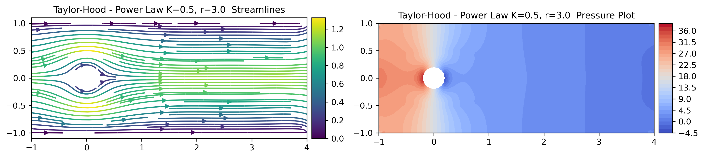

# StokesFEM

A modular FEniCS testbed for experimenting with and comparing finite element formulations for the incompressible Stokes equations.

Originally developed for a university project in **Numerical Analysis for Differential Equations (NADE)**, this repository was built to automate the tedious parts of benchmarking—swapping function spaces, running $h$-refinement loops, tracking Experimental Orders of Convergence (EOC), and handling non-Newtonian rheologies. The codebase applies clean software engineering practices (decoupled strategies, modular fluid models, factory dispatch) without overcomplicating what is fundamentally a student research sandbox.

---

## What This Project Does

The core objective was to systematically evaluate how different finite element spaces and variational formulations behave under both linear (Newtonian) and nonlinear (Power-Law, Carreau) regimes.

Instead of writing monolithic, single-use simulation scripts, the framework decouples the problem into interchangeable components:
- **Constitutive Models:** Pluggable rheology laws ($\mu = \text{const}$, Ostwald–de Waele Power-Law, Carreau).
- **Solver Strategies:** Linear solvers, lagged fixed-point (Picard) iteration, Newton–Raphson, and hybrid Picard–Newton cascades.
- **Discretization Schemes:** Classical primal velocity-pressure pairs, dual mixed elements, and augmented stress-velocity formulations.
- **Automated Verification:** Method of Manufactured Solutions (MMS) benchmarking with online $L^2$, $H^1_0$, and $H(\text{div})$ error tracking.

---

## Mathematical Formulations & Discretizations

The generalized steady incompressible Stokes problem models creeping flow for viscous fluids:

$$
\begin{aligned}
-\nabla \cdot (2\mu(\mathbf{D})\mathbf{D}) + \nabla p &= \mathbf{f} \quad \text{in } \Omega, \\
\nabla \cdot \mathbf{u} &= 0 \quad \text{in } \Omega,
\end{aligned}
$$

where $\mathbf{u}$ is the velocity, $p$ is the pressure, $\mathbf{D}(\mathbf{u}) = \mathrm{sym}(\nabla \mathbf{u})$ is the symmetric strain-rate tensor, and $\boldsymbol{\sigma} = 2\mu(\mathbf{D})\mathbf{D}(\mathbf{u}) - p\mathbf{I}$ is the Cauchy stress tensor.

Because discrete velocity, pressure, and stress spaces must satisfy Ladyzhenskaya–Babuška–Brezzi (inf-sup) stability, multiple discrete approaches are implemented:

- **Primal Formulations ($\mathbf{u}, p$):**
  * Taylor–Hood ($\mathbb P_{k+1}/ \mathbb P_{k}$)
  * MINI element ($\mathbb{P}_1 + \text{bubble} / \mathbb{P}_1$)
  * Kouhia–Stenberg (KS)

- **Mixed Dual Formulations ($\boldsymbol{\sigma}, \mathbf{u}$):**
  * Arnold–Falk–Winther (AFW)
  * Raviart–Thomas / Continuous Galerkin (RT-CG)
  * Hybridized Mixed Methods
   
- **Augmented Formulations ($\mathbf{T}, \mathbf{R}, \mathbf{u}$):**
  * Augmented BDM ($`\mathrm{BDM}_k \times \mathrm{BDM}_k \times \mathrm{DG}_{k-1}`$)
  * Augmented RT ($`\mathrm{RT}_k \times \mathrm{RT}_k \times \mathrm{DG}_{k-1}`$)

---

## Usage Examples

### 1. Non-Newtonian Flow Past an Obstacle

Simulate channel flow around a circular cylinder using a Power-Law fluid ($K = 0.5, r = 3.0$), discretized with Taylor–Hood (`TH`) elements and solved via Newton–Raphson iteration with an initial linear guess ($\mu_{\text{guess}} = 0.2$):

```python
from commons import MethodType, PowerLawModel
from problems.obstacle import generate_problem
from solvers import SolverFactory
from solvers.strategies import NewtonStrategy
from postprocessing import plots

# 1. Generate the channel mesh with a circular obstacle
problem_data = generate_problem(n=64)

# 2. Configure the rheology model and nonlinear solver strategy
model = PowerLawModel(K=0.5, r=3.0)
strategy = NewtonStrategy(mu_guess=0.2)

# 3. Instantiate the Taylor-Hood solver and solve the system
solver = SolverFactory.create_solver(method=MethodType.TH, fluid_model=model)
solution = solver.solve(data=problem_data, strategy=strategy)

# 4. Plot velocity streamlines and pressure field
fig, axes = plots.plot_combined(
    solution=solution,
    mode="streamlines",
    title_prefix="TH - Power Law (K=0.5, r=3.0)",
    layout="vertical",
)
fig.savefig("results/obstacle/obstacle_TH.png", dpi=300)
```



### 2. Automated MMS Study

Verifying non-Newtonian solvers via the Method of Manufactured Solutions (MMS) typically requires tedious, error-prone manual calculus to derive the exact forcing vector $\boldsymbol{f} = -\nabla \cdot (2\mu(\boldsymbol{D}(\boldsymbol{u}_{\text{exact}}))\boldsymbol{D}(\boldsymbol{u}_{\text{exact}}) - p_{\text{exact}}\boldsymbol{I})$ and boundary tractions whenever the rheology changes.

In `problems/analytical.py`, this process is fully automated using UFL symbolic differentiation, enabling **plug-and-play rheologies**: testing a new constitutive law requires nothing more than subclassing `FluidModel`—the MMS benchmark adapts automatically.

Run a multi-method $h$-refinement loop comparing Taylor–Hood (`TH`), Augmented BDM (`AUG_BDM`), and Arnold–Falk–Winther (`AFW`) elements under a nonlinear Power-Law regime using a hybrid Picard–Newton cascade.

```python
from commons import MethodType, PowerLawModel
from problems.analytical import generate_problem
from solvers import SolverFactory
from solvers.strategies import HybridStrategy
from postprocessing import ConvergenceStudy, ConvergencePlotter, compute_errors

# 1. Configure nonlinear rheology, hybrid solver strategy, and mesh refinements
model = PowerLawModel(K=0.5, r=2.5)
strategy = HybridStrategy()
refs = [2, 4, 8, 16, 32]
methods = [MethodType.TH, MethodType.AUG_BDM, MethodType.AFW]

plotter = ConvergencePlotter("h", prefix="MMS - Power Law K=0.5, r=2.5", normalized=True)
studies = []

# 2. Run h-refinement across all discretization schemes
for method in methods:
    study = ConvergenceStudy(method)
    for n in refs:
        # Automatically derives symbolic forcing & BCs for the chosen rheology
        data = generate_problem(n=n, model=model)
        solver = SolverFactory.create_solver(method=method, fluid_model=model)

        solution = solver.solve(data=data, strategy=strategy)
        errors = compute_errors(data, solution, method)
        study.add_error_data(errors, h=1 / n)

    # Print formatted Experimental Order of Convergence (EOC) table to console
    study.print_table()
    studies.append(study)

# 3. Export log-log convergence plots with reference slopes (O(h), O(h^2), O(h^3))
figures = plotter.plot_from_studies(studies, reference_orders=[1, 2, 3])
for error_type, fig in figures.items():
    fig.savefig(f"results/analytical/convergence_{error_type}.png", dpi=300)
```


---

## Repository Structure & Architecture

The testbed decouples benchmark physics, variational formulations, and nonlinear solvers into focused modules:

```text
StokesFEM/
├── benchmarks/                # Verification & physical benchmark entry points
│   ├── test_convergence.py    # Multi-method h-refinement MMS study
│   ├── test_cavity.py         # Lid-driven cavity benchmark
│   └── test_obstacle.py       # Flow past a circular cylinder
├── commons/                   # Enums, containers, and pluggable rheology models
│   └── rheology.py            # Linear, Power-Law (Ostwald–de Waele), and Carreau fluid laws
├── problems/                  # Meshing, boundary markers, and symbolic physics setup
│   ├── analytical.py          # Automated symbolic UFL MMS problem generator
│   ├── cavity.py              # Lid-driven cavity domain definition
│   └── obstacle.py            # Channel flow around an obstacle
├── solvers/                   # Variational formulations and factory dispatch
│   ├── factory.py             # SolverFactory matching MethodType to formulation
│   ├── primal.py              # Velocity-pressure pairs (Taylor–Hood, MINI, Kouhia–Stenberg)
│   ├── mixed.py               # Dual mixed spaces (AFW, RT-CG)
│   ├── augmented.py           # Augmented stress-velocity spaces (Augmented BDM/RT)
│   └── strategies/            # Nonlinear solver algorithms
│       ├── linear.py          # Standard direct/iterative linear solver
│       ├── picard.py          # Fixed-point Picard iteration
│       ├── newton.py          # Newton–Raphson with exact tangent Jacobian
│       └── hybrid.py          # Picard-initialized Newton cascade
├── postprocessing/            # Verification and visualization routines
│   ├── errors.py              # Functional L2, H1_0, and H(div) error computation
│   ├── metrics.py             # ConvergenceStudy tracker and EOC calculation
│   ├── convergence_plotter.py # Multi-order log-log convergence curves
│   └── plots.py               # Matplotlib streamlines and pressure contours
└── notebooks/                 # Interactive exploration and postprocessing tutorials
```

### Module Roles & Extensibility

- **`commons/` — Pluggable Constitutive Laws**  
  Contains core abstractions and rheology definitions (`LinearModel`, `PowerLawModel`, `CarreauModel`).

- **`problems/` — Automated Symbolic Problem Setup**  
  Packages geometry, mesh data, and boundary markers into a unified `StokesProblemData` container.

- **`solvers/` & `strategies/` — Decoupled Discretizations and Solvers**  
  * `solvers/` defines the mixed variational spaces and weak forms (primal, dual mixed, and augmented), instantiated through `SolverFactory`[cite: 1].  
  * `strategies/` decouples how the nonlinear system is solved (`PicardStrategy`, `NewtonStrategy`, `HybridStrategy`) from the specific finite element formulation being evaluated.

- **`postprocessing/` — Error Analysis & EOC Verification**  
  Evaluates functional errors across spaces ($L^2$, $H^1_0$, and $H(\text{div})$), calculates Experimental Orders of Convergence (EOC), and handles convergence plots alongside flow visualizations.

---

## Installation & Quickstart

This framework relies on legacy **FEniCS (2019.1.0)** and `mshr`. Creating the Conda environment from `environment.yml` automatically installs all dependencies and registers the package in editable mode (`pip install -e .`):

```bash
# 1. Create the Conda environment (automatically installs the package in editable mode)
conda env create -f environment.yml

# 2. Activate the environment
conda activate stokes-fem

# 3. Run the benchmark suites
python benchmarks/test_convergence.py
python benchmarks/test_obstacle.py
python benchmarks/test_cavity.py
```
